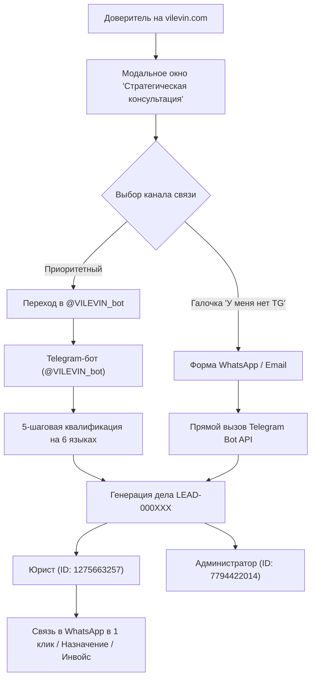

# 📋 ТЕХНИЧЕСКОЕ ЗАДАНИЕ (ТЗ) / ARCHITECTURE & SPECIFICATION SPEC
## Проект: Премиальная международная юридическая экосистема V. I. LEVIN (vilevin.com)
**Кодовое имя:** `v-i-levin-legal`  
**Платформа разработки:** Google Antigravity Agentic IDE  
**Репозиторий:** `https://github.com/PulseAff/v-i-levin-legal.git`  
**Боевой домен:** `https://vilevin.com`  
**Сервер автоматизации / VPS:** `41.216.188.196` (Ubuntu 22.04 LTS)  
**Telegram Bot:** `@VILEVIN_bot`  

---

## 1. НАЗНАЧЕНИЕ И ЦЕЛИ СИСТЕМЫ

Система представляет собой закрытую цифровую инфраструктуру премиальной международной юридической практики **V. I. LEVIN**.  
Она объединяет:
1. **Презентационный и контентный веб-портал** международного уровня (США, ЕС, ОАЭ, СНГ) с высокой конверсией в обращение.
2. **Интеллектуальный квалификатор доверителей** в Telegram-боте на 6 языках.
3. **Бесшовный шлюз приема и маршрутизации заявок** (веб-сайт -> Telegram Bot API -> юрист и супервайзер).
4. **Криптовалютный и банковский модуль расчетов** (CryptoBot / Cryptomus USDT TRC-20, SWIFT/SEPA).
5. **SEO & Аналитический контур** (Google Analytics 4, Google Search Console, Bing Webmaster Tools, Schema.org).

---

## 2. АРХИТЕКТУРА И ТЕХНОЛОГИЧЕСКИЙ СТЕК

### 2.1. Веб-портал (Frontend & Client Core)
* **Фреймворк:** Next.js 14 (App Router, Static Site Generation — `output: 'export'`).
* **UI/UX стек:** React 18, TypeScript 5, Tailwind CSS v3.4, Framer Motion v11, Lucide React Icons.
* **Типографика:** Cormorant Garamond (премиальная антиква для заголовков), Inter (гротеск для чтения).
* **Стилистика:** Тёмная благородная палитра (`#05070D` Deep Obsidian, `#D4AF37` Imperial Gold, стеклянный морозный морфизм, золотая печать V. I. Levin).
* **CDN & Edge:** Cloudflare (SSL/TLS Full Strict, HTTP/3, Brotli, DDoS-защита, кеширование статики).

### 2.2. Бэкенд и Telegram-бот (Operations Daemon)
* **Среда выполнения:** Node.js v20+ LTS на выделенном сервере VPS `41.216.188.196`.
* **Управление процессом:** `systemd` сервис `vilevin_bot.service` (автозапуск, RestartSec=5, логирование в journalctl).
* **Канал связи сайта с Telegram:** 
  - Прямой вызов Telegram Bot API `https://api.telegram.org/bot<TOKEN>/sendMessage` со стороны клиента с автоматическим дублированием и fallback-режимом.
* **Хранилище данных (Persistent Flat DB):**
  - `data/bot_users.json` — база зарегистрированных пользователей и клиентов бота.
  - `data/lead_counter.json` — счетчик сквозных последовательных номеров дел (`LEAD-000100`+).
  - `data/leads.json` — журнал квалифицированных обращений.

---

## 3. МОДУЛИ СИСТЕМЫ И ФУНКЦИОНАЛЬНЫЕ ТРЕБОВАНИЯ



### 3.1. Модальное окно консультации (`ConsultationModal.tsx`)
1. **Двухуровневый UX:**
   - **Экран 1 (Приоритет):** Центрированная золотая круглая печать V. I. Levin (кликабельная), текст о защищенном юридическом intake через Telegram, кнопка быстрого перехода в `@VILEVIN_bot`.
   - **Экран 2 (Раскрывающийся чекбокс «У меня нет Telegram»):**
     * Выбор сферы (США & Визы, Бизнес & Контракты, Арбитраж, Защита активов, Банки & Санкции).
     * Интерактивные чипсы подкатегорий (EB-1A, NIW, Трасты, LCIA и др.).
     * Поля: WhatsApp / телефон, Email, краткая суть вопроса.
2. **Надежность доставки (Zero-Drop Guarantee):**
   - Экранирование текста через `escapeHtml()`.
   - Валидные инлайн-кнопки (только протокол `https://wa.me/...`).
   - Автоматический fallback: если HTML-разметка Telegram сбоит, скрипт мгновенно отправляет заявку чистым текстом без разметки.
   - Заявка параллельно отправляется и супервайзеру, и практикующему юристу.

### 3.2. Telegram-бот квалификации (`scripts/run-bot.js`)
1. **Мультиязычность:** Полная поддержка 6 языков (RU, EN, UK, ES, IT, FR) в меню, кнопках и вопросах.
2. **Квалификационный опросник:**
   - Шаг 1: Юрисдикция и статус доверителя.
   - Шаг 2: Категория права и задача.
   - Шаг 3: Срочность и бюджетный диапазон.
   - Шаг 4: Описание ситуации.
   - Шаг 5: Контакт для связи (кнопка «Поделиться контактом» или ручной ввод).
3. **Маршрутизация и инлайн-панель:**
   - Карточка дела с заголовком `⚖️ V. I. LEVIN | НОВАЯ ЗАЯВКА`.
   - Кнопка прямого звонка/сообщения в WhatsApp доверителю.
   - Кнопка выставления счета в USDT (CryptoBot Pay API).
4. **Служебные команды для юриста и администратора:**
   - `/stats` — сводка по заявкам и конверсиям.
   - `/users` — список доверителей, начавших диалог с ботом.
   - `/reply <chat_id> <текст>` — защищенный ответ доверителю от имени практики.

### 3.3. Тест на получение Green Card США (`/usa/immigration-test`)
* Интерактивный опросник из 7 критериев экстраординарных способностей (EB-1A) и национального интереса (EB-2 NIW).
* Динамический скоринг шансов в % с рекомендацией индивидуальной стратегии.
* Прямая передача результатов теста в форму консультации.

---

## 4. СЛУЖЕБНЫЕ ИДЕНТИФИКАТОРЫ И ПЕРЕМЕННЫЕ ОКРУЖЕНИЯ

| Параметр | Значение | Описание |
| :--- | :--- | :--- |
| `TELEGRAM_BOT_TOKEN` | `8805827853:AAGALkEhBOUTe2xNiKbehggEnC0cAKvwV-0` | Токен бота @VILEVIN_bot |
| `TELEGRAM_ADMIN_CHAT_ID` | `7794422014` | Супервайзер / Администратор (@Velionist) |
| `TELEGRAM_LAWYER_CHAT_ID` | `1275663257` | Практикующий юрист (оканчивается на 257) |
| `NEXT_PUBLIC_GA_ID` | `G-ZQGBVN9N3B` | Google Analytics 4 Measurement ID |
| `CRYPTOBOT_API_TOKEN` | `639849:AAmtxJLr8fp7NjDPccBJmJi9MOXSCfX4fpD` | CryptoBot Pay Merchant API |
| `USDT_TRC20_WALLET` | `TR7NHqjeKQxGTCi8q8ZY4pL8otSzgjLj6t` | Резервный кошелек USDT TRC-20 |

---

## 5. ИНСТРУКЦИИ ПО ДЕПЛОЮ И ЭКСПЛУАТАЦИИ

### 5.1. Локальная сборка и проверка целостности
```powershell
# Проверка типов TypeScript
npm run type-check

# Сборка статического продакшн-бандла
npm run build
```

### 5.2. Публикация изменений веб-сайта
```powershell
git add .
git commit -m "feat/fix: описание изменений"
git push origin main
```
*Изменения автоматически подхватываются боевым хостингом `vilevin.com`.*

### 5.3. Деплой и перезапуск Telegram-бота на VPS
Используется автоматизированный скрипт:
```powershell
python C:\Users\admin0\.gemini\antigravity\brain\e97993fc-d26f-413c-99a0-3be20ceb061a\scratch\deploy_vilevin_bot.py
```
*Скрипт по SSH обновляет код бота, переменные `.env`, файл счетчика `lead_counter.json`, выполняет `systemctl daemon-reload` и перезапускает службу `vilevin_bot.service` с проверкой логов.*

---

## 6. КРИТЕРИИ ПРИЕМКИ (ACCEPTANCE CRITERIA)
1. **Скорость и адаптивность:** Время отклика страниц < 1 сек на мобильных устройствах, корректное отображение на экранах от 360px до 4K.
2. **Гарантия доставки лида:** При отправке заявки с сайта без Telegram сообщение поступает юристу (`1275663257`) и админу (`7794422014`) в течение 1–2 секунд.
3. **Безошибочность Telegram API:** Исключены ошибки `BUTTON_URL_INVALID` и поломки парсинга разметки.
4. **Аналитика:** События просмотров и конверсий корректно фиксируются в реальном времени в GA4 (`G-ZQGBVN9N3B`).
