# ⚖️ V. I. LEVIN | Комплексная SEO & GEO Стратегия и Рекомендации по Продвижению

**Домен:** [https://vilevin.com](https://vilevin.com)  
**Ниша:** Международная юридическая практика высшего сегмента (YMYL: Premium Legal Services, US Immigration EB-1A / EB-2 NIW, International Arbitration, Cross-border Wealth Protection)  
**Целевые регионы:** США, ЕС, ОАЭ, Великобритания, СНГ (экспаты и международный бизнес)  
**Языки:** Русский, Английский, Украинский, Испанский, Итальянский, Французский  

---

## 1. Текущий технический аудит и фундамент (Baseline)

### Что уже реализовано на отлично:
1. **Технологический стек:** Next.js 14 App Router, SSG (Static Site Generation), Tailwind CSS, Framer Motion. Время первой отрисовки (FCP) < 0.8s, Cumulative Layout Shift (CLS) близко к 0.
2. **Безопасность и доставка:** Cloudflare CDN, Strict HTTPS, HSTS, Brotli/Gzip сжатие.
3. **Индексация и краулинг:**
   - Динамический `robots.txt` с разрешением индексации и закрытием служебных эндпоинтов (`/api/`, `/admin/`).
   - Динамический `sitemap.xml` на 34+ ключевых URL с приоритетами (1.0 для корня и `/usa/green-card`) и датами обновления.
4. **Микроразметка Schema.org:**
   - Внедрен семантический граф JSON-LD: `@type: ['LegalService', 'Attorney']`, `WebSite`, `OfferCatalog`, список стран `areaServed`, `currenciesAccepted` (включая USDT, BTC, USD, EUR).
5. **Верификация и трекинг:**
   - Подтвержден **Google Search Console**.
   - Подтвержден **Bing Webmaster Tools** (синхронизирован с GSC).
   - Интегрирован **Google Analytics 4** (`G-ZQGBVN9N3B`) через нативные теги в `<head>`.

---

## 2. Стратегия поискового продвижения в юридической нише (Google YMYL & E-E-A-T)

В категории юридических услуг Google применяет жесточайшие алгоритмические фильтры **YMYL** (*Your Money Your Life*) и оценивает авторитетность по стандартам **E-E-A-T** (*Experience, Expertise, Authoritativeness, Trustworthiness*).

### 2.1. Укрепление факторов E-E-A-T на сайте:
* **Страница юриста (`/about`):**
  - Добавить детальный профессиональный профиль: юрисдикции допуска к практике (Bar Admissions, лицензии, ассоциации — ABA, AILA, IBA при наличии).
  - Указать конкретные прецеденты и институты арбитража (LCIA, ICC, AAA/ICDR).
  - Ссылки на внешние независимые авторитетные профили: LinkedIn, Crunchbase, публикации в СМИ.
* **Правовые дисклеймеры (Legal Compliance):**
  - Разместить в футере четкий `Attorney Advertising Notice` и дисклеймер об отсутствии отношений «адвокат-клиент» до подписания соглашения (Attorney-Client Relationship Disclaimer), что повышает доверие модераторов Google и рекламных сетей.

---

## 3. Семантическое ядро и приоритетные кластеры запросов

### Кластер 1. Иммиграция в США высшего класса (High-Intent, максимальный LTV)
* **Запросы (RU):**
  - `виза талантов сша eb-1a требования`
  - `eb-1a vs eb-2 niw отличия`
  - `грин карта сша для предпринимателей и основателей стартапов`
  - `период рассмотрения eb-1a premium processing 2026`
  - `критерии kazarian v uscis eb-1a адвокат`
  - `подготовка к консульскому собеседованию на иммиграционную визу сша`
* **Запросы (EN):**
  - `eb1a lawyer us immigration`
  - `eb2 niw for tech founders`
  - `extraordinary ability green card attorney new york`
  - `matter of dhanasar niw criteria guide`

### Кластер 2. Трансграничный бизнес, контракты и комплаенс
* **Запросы (RU / EN):**
  - `структурирование бизнеса сша оаэ difc`
  - `международный b2b контракт применимое право арбитражная оговорка`
  - `открытие счетов в зарубежных банках комплаенс юрист`
  - `разблокировка активов санкции ofac комплаенс`

### Кластер 3. Защита частного капитала и трасты
* **Запросы:**
  - `безотзывный траст невада южная дакота защита активов`
  - `asset protection trust foreign grantor trust us tax`
  - `международное структурирование семейных активов`

---

## 4. On-Page SEO: конкретные точки роста для vilevin.com

### 4.1. Расширение Schema.org микроразметки
1. **`FAQPage` Schema:**
   - На страницы `/services/*`, `/usa/green-card` и `/usa/immigration-test` добавить разметку FAQ.
   - *Результат:* появление раскрывающихся списков вопросов прямо в сниппете выдачи Google, что увеличивает CTR на 25–40%.
2. **`BreadcrumbList` Schema:**
   - Разметка «хлебных крошек» для вложенных страниц: `Главная → Услуги → Иммиграция США`.
3. **`Article` Schema:**
   - На страницах `/articles/[slug]` указать `author`, `datePublished`, `dateModified`, `publisher`.

### 4.2. Архитектура мультиязычности (Hreflang)
* Сейчас на сайте мультиязычность переключается параметром `?lang=XX`.
* **Стратегический шаг для международного SEO:**
  - В следующем мажорном обновлении перевести языковые версии на статические подпапки: `vilevin.com/en/`, `vilevin.com/es/`, `vilevin.com/fr/`.
  - Поисковые роботы Google индексируют структуру с подпапками значительно лучше, чем query-параметры `?lang=`.
  - Текущий тег `<link rel="alternate" hreflang="..." />` уже настроен в `layout.tsx` и `sitemap.ts`, что страхует текущую индексацию.

---

## 5. GEO (Generative Engine Optimization) — оптимизация под нейросети и AI-поиск

В 2026 году более 35% юридических запросов проходят через **ChatGPT Search, Perplexity, Claude и Google AI Overviews**.

### Правила ранжирования в AI-выдаче:
1. **Q&A формат первого абзаца:**
   Каждая статья и страница услуги должна начинаться с прямого, концентрированного ответа (2–3 предложения) без вводных «воды». Нейросети вырезают именно этот фрагмент в качестве ответа пользователю.
2. **Точные юридические ссылки на нормы права:**
   Нейросети цитируют источники, где есть точные правовые ссылки:
   - *Пример:* `8 CFR § 204.5(h)(3)`, прецеденты `Kazarian v. USCIS 596 F.3d 1115`, `Matter of Dhanasar, 26 I&N Dec. 884`.
3. **Сравнительные таблицы:**
   Таблицы (например, «EB-1A vs EB-2 NIW: Сроки, Критерии, Одобрения») считываются LLM в первую очередь как структурированные знания.

---

## 6. Внешняя оптимизация (Off-Page SEO & Цифровой PR)

### 6.1. Белые юридические директории и каталоги (Tier-1)
* Регистрация профиля V. I. LEVIN:
  - **Google Business Profile** (с локацией в США/Нью-Йорк при наличии адреса)
  - **Bing Places for Business**
  - **Crunchbase** (карточка юридической практики и основателя)
  - **Avvo, Justia, FindLaw, Martindale-Hubbell**
  - **Clutch.co, GoodFirms** (в категориях Legal & Corporate Services)

### 6.2. Экспертный контент-маркетинг (Tier-2)
* Публикация адаптированных статей с обратными ссылками на первоисточник:
  - **Medium & Substack:** англоязычные лонгриды по иммиграции основателей стартапов и венчурных инвесторов.
  - **VC.ru / Habr:** кейсы получения Green Card для IT-фаундеров, AI-исследователей и топ-менеджеров.
  - **LinkedIn Articles:** B2B аналитика по арбитражу и комплаенсу.

---

## 7. Конверсионное SEO и Аналитика (CRO & Event Tracking)

Сайт уже подключен к Google Analytics 4 (`G-ZQGBVN9N3B`) и сквозному боту `@VILEVIN_bot`. Рекомендуется настроить следующие пользовательские события в GA4:

| Событие | Триггер | Бизнес-ценность |
| :--- | :--- | :--- |
| `click_telegram_bot` | Клик по кнопке Telegram / переход в бота | Основной лид-магнит (теплая аудитория) |
| `submit_direct_consultation` | Отправка модального окна без Telegram (WhatsApp/Email) | Прямой лид (горячая заявка) |
| `immigration_test_complete` | Завершение теста шансов на визу США | Квалифицированный лид |
| `click_whatsapp_direct` | Клик по кнопке перехода в WhatsApp | Быстрый контакт |

---

## 8. Дорожная карта на 30–60–90 дней

```mermaid
flowchart LR
    A["День 1–30: Базис"] --> B["День 31–60: Контент & E-E-A-T"]
    B --> C["День 61–90: Масштабирование & Ссылочный вес"]
    
    subgraph A["День 1–30"]
        direction TB
        A1["Контроль индексации в GSC и Bing"]
        A2["Разметка FAQPage & Breadcrumbs"]
        A3["Настройка целей и конверсий в GA4"]
    end

    subgraph B["День 31–60"]
        direction TB
        B1["Публикация 6 флагманских статей (EB-1A, NIW, Трасты)"]
        B2["Усиление E-E-A-T атрибутов юриста"]
        B3["Оптимизация под Google AI Overviews"]
    end

    subgraph C["День 61–90"]
        direction TB
        C1["Запуск внешних публикаций (Medium, VC, PR)"]
        C2["Регистрация в топ-каталогах (Crunchbase, Clutch)"]
        C3["A/B тест конверсии модального окна"]
    end
```

---
*Документ актуален для международной практики V. I. LEVIN (vilevin.com).*
